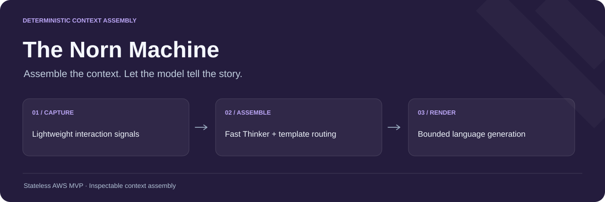
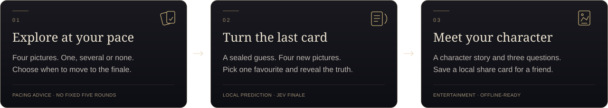
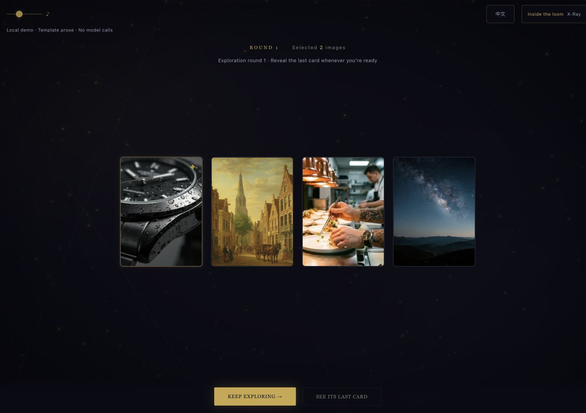
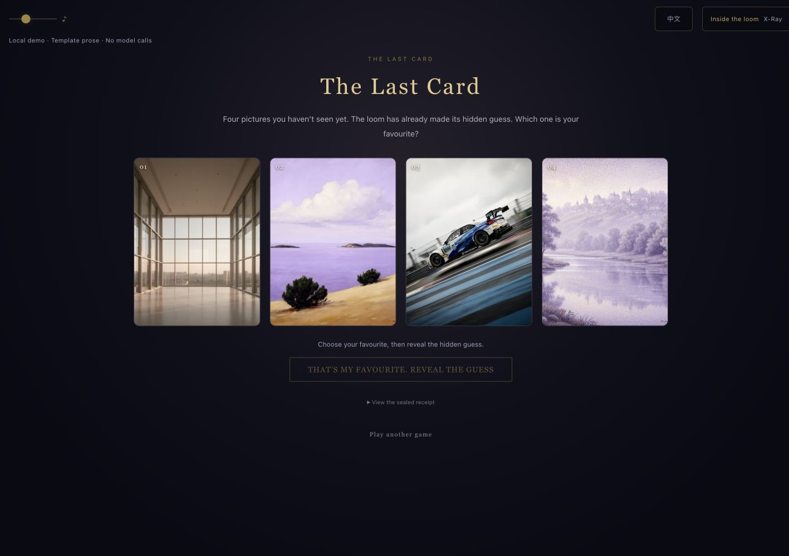
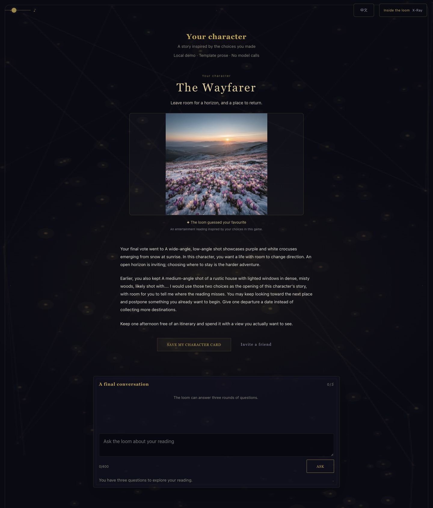
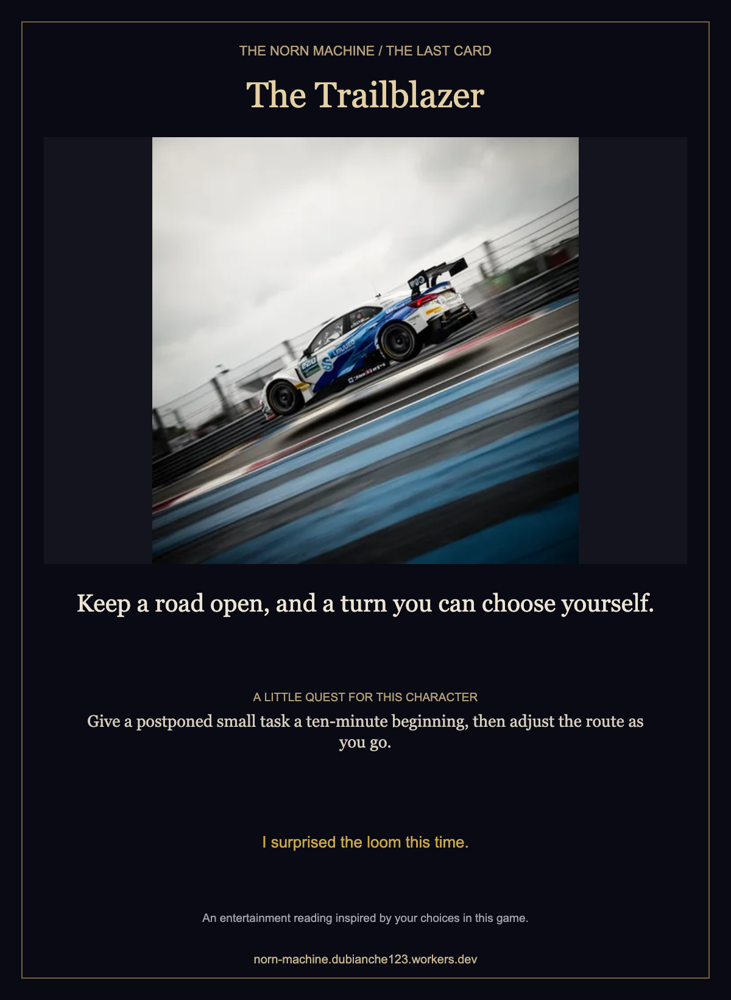
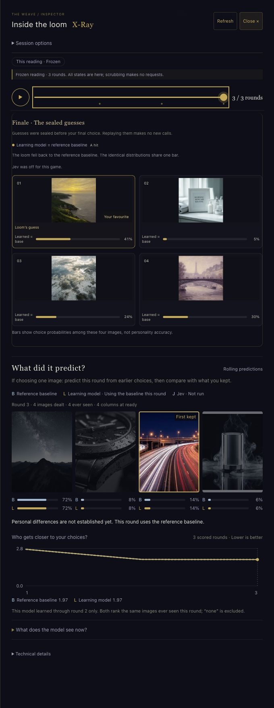
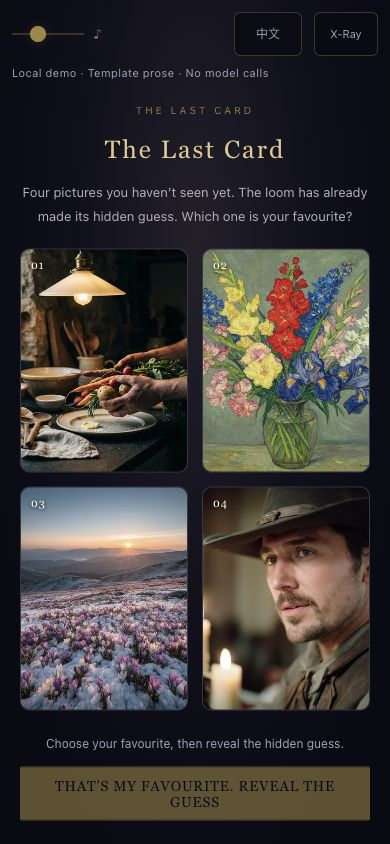
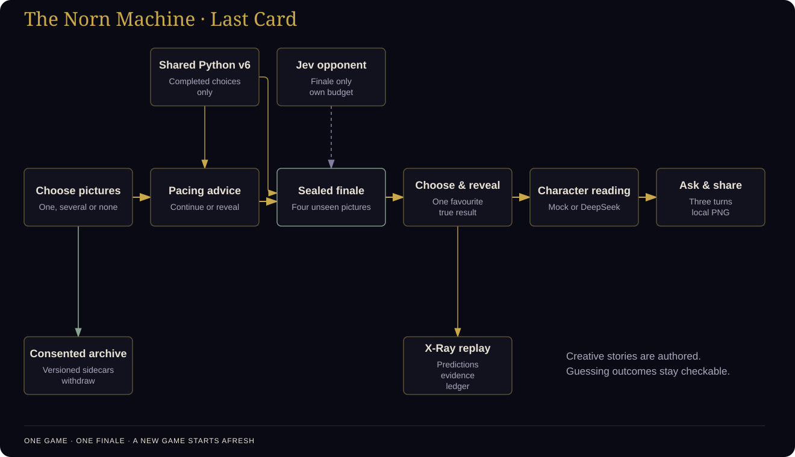

<div align="center">

# The Norn Machine · 命运织机

**Choose with your eyes. Make the loom show its hand.**

[](https://github.com/dubianche123/norn-context-engineering/actions/workflows/ci.yml)
[](pyproject.toml)
[](LICENSE)
[](https://norn-machine.dubianche123.workers.dev/)
[](#run-locally)

### [Play online →](https://norn-machine.dubianche123.workers.dev/) · [Run locally →](#run-locally)

**English** · [简体中文](README_CN.md) · [Architecture](#architecture) · [Model and deck](docs/research-deck.md)



</div>

Norn's **Last Card** is a game of visual intuition. Explore pictures, then choose your favourite from four you have never seen in this game. The loom has already sealed its guess. Reveal the result, meet the character inspired by your choices, and take a picture card home to share.

The game follows your pace. After each completed exploration round, a versioned policy can suggest continuing or moving to the finale. You can choose the finale yourself after the first round. There is one finale per game, followed by a fresh game if you want another go—no fixed five-round test or claim that a particular number of choices is enough to know you.

## Show your hand

<p align="center">
  
</p>

**1 / Follow your eye.** Keep one, several, or none of four pictures. Undo and change your choices freely. The pacing suggestion is an invitation, and you can choose when to move on.

<p align="center">
  
</p>

**2 / Make the loom show its hand.** Four new pictures appear after the server has sealed its prediction. Choose your one favourite and turn over the hidden guess. A hit stays a hit; a miss stays a miss.

<p align="center">
  
</p>

**3 / Meet your character.** Your favourite becomes the main picture of an authored character card. Read its story, challenge its interpretation in up to three follow-up turns, then download a shareable PNG created in your browser. Saving a card uploads nothing.

<p align="center">
  
</p>

Character readings are entertainment inspired by this game's pictures. Their names and stories are creative interpretation, rather than psychological classes measured by the preference model. The real guessing result remains separate and checkable.

<details>
<summary>A card to take home</summary>
<p>The downloaded card combines your favourite, character, a small invitation and the real guessing outcome. It is generated locally; you decide whether to send it to anyone.</p>
<p align="center">
  
</p>
</details>

<details>
<summary>Look behind the curtain with X-Ray</summary>
<p>Replay the choices, inspect the pre-choice predictions and compare them with the true result. When the learning model falls back to the reference, X-Ray says so instead of presenting matching outputs as independent evidence.</p>
<p align="center">
  
</p>
</details>

<details>
<summary>Play on a phone</summary>
<p align="center">
  
</p>
</details>

The interface pictures are separately captured in English and Chinese. Local mock captures use the real fitting, pacing, sealed-guess and replay code with explicitly labelled template prose; they are interface demonstrations, not visitor-study results.

## Your game, your choice about data

You receive the same complete game, character, questions and share card whether you contribute data or play privately. Anonymous contribution is optional and withdrawable. With consent, incomplete exploration is checkpointed too, including the current round's real choices and provisional attention; a later full result replaces that visit's partial record. Closing a browser can still prevent the final best-effort save.

**Jev is a separate opponent.** Where the server provides it, Last Card enables Jev before entry and lets you switch it off there. It uses one paid prediction attempt for the finale rather than a call every exploration round. Earlier choices and numerical candidate features go to Typesafe; the interface makes that visible before you start. No configured key or available result means no invented opponent result. Round-by-round local feedback has its own pre-start switch, off by default. See [the gameplay and resource contract](docs/last-card.md).

## Run locally

Requires **Python 3.12+**. From the repository root:

```bash
python3 -m norn doctor
python3 -m norn serve --mock
```

Open [localhost:8765](http://127.0.0.1:8765), or add `--port 8766`. All 256 WebP images in the PAM∃LA deck, their numerical features and the frontend ship in the repository. No AWS account, API key, network connection or third-party Python runtime package is needed for local mock play.

`--mock` replaces language generation with authored offline stories. The model, pacing decisions, server-sealed finale, real hit/miss and X-Ray still execute. A configured DeepSeek route supplies live prose on the hosted site. The earlier deck remains available explicitly with `--deck classic`.

## Architecture

<p align="center">
  
</p>

The local server and Cloudflare Worker share the Python event validation and v6 model. The model predicts picture choices. A separate, versioned creative context supplies the character story to local templates or the language model. The favourite from the finale is never quietly fed back into the exploration model that made the guess.

| Part | Responsibility |
| --- | --- |
| Exploration + v6 | A real choice journal, small-sample shrinkage, evidence gates and additive score ledger. |
| Pacing policy | Advice based on completed history, with recorded offer probabilities; the first policy is exploratory and **has not been trained**. |
| Sealed finale | Four unseen pictures, hidden server-owned prediction, immutable favourite and a verifiable reveal. |
| Creative reading | An authored role, specific picture-grounded prose, three questions and a local share card. |
| X-Ray | Real replay and model boundaries, including honest reference fallback and any timely Jev result. |
| Optional archive | Versioned product/pacing/finale sidecars, partial visits, consent and withdrawal. |

**Research question.** Can a system learn useful picture preferences from sparse, voluntary play, and decide when another exploration round is worth its cost? Can an interesting finale coexist with checkable predictive evidence? The product supplies one enjoyable experience; analysis follows its versioned observations. Paper datasets, experiments and raw research results remain in the separate local research workspace. This README reports the question, not experimental effect sizes.

Current product records use a dedicated `.last-card.v1` cohort, with a further `.round-feedback.v1` suffix when live round feedback is enabled. They do not silently enter the earlier frozen visitor protocol. See [measurement](docs/measurement.md), [X-Ray](docs/xray.md) and [deck/model details](docs/research-deck.md).

## Live prose and hosting

To select an explicit compatible model endpoint locally:

```bash
export NORN_BASE_URL='http://127.0.0.1:8000/v1'
export NORN_MODEL='your-model-name'
python3 -m norn serve --provider openai-compatible
```

Set `NORN_API_KEY` if required by that endpoint. Hosted prose uses the official DeepSeek route, with credentials held on the server. Jev uses a separate server-held secret and quota. Cloudflare Workers serves the static assets and same-origin APIs; isolated Durable Objects hold temporary game/conversation state, shared budgets and consented archives. [Deployment instructions](docs/deployment.md) also cover other providers and Docker.

## Verification and code guide

```bash
python3 -m pip install '.[dev]'
python3 -m pytest
git diff --check
```

Tests cover deterministic replay, actual-prefix pacing, hidden commitments, immutable favourite choices, actor restoration, bilingual character generation, consent/cohort boundaries and responsive interface behaviour. Engineering checks do not establish personality accuracy or a human recommendation benefit.

| Start here | What it explains |
| --- | --- |
| [Gameplay contract](docs/last-card.md) | Full loop, pacing, the sealed finale, Jev budget and sharing. |
| [Deck and v6](docs/research-deck.md) | Reference ratings, image features, model gates and dealing. |
| [Measurement](docs/measurement.md) | Separate predictive, product and entertainment outcomes. |
| [Pacing evaluation](docs/pacing.md) | Offline grouped holdout reports and a candidate policy that cannot deploy itself. |
| [X-Ray](docs/xray.md) | Comparable candidates, fallback, timely predictions and replay. |
| [Frontend](the-norn-machine/frontend/) · [service](norn/service.py) | Product stages and shared authoritative APIs. |
| [Collection](norn/collection.py) · [Cloudflare](cloudflare/) | Checkpoints, withdrawal and hosting adapters. |

PAM∃LA images are **CC BY 4.0** ([attribution](the-norn-machine/frontend/assets/decks/pamela-v1/ATTRIBUTION.md)); the code is [MIT licensed](LICENSE).
