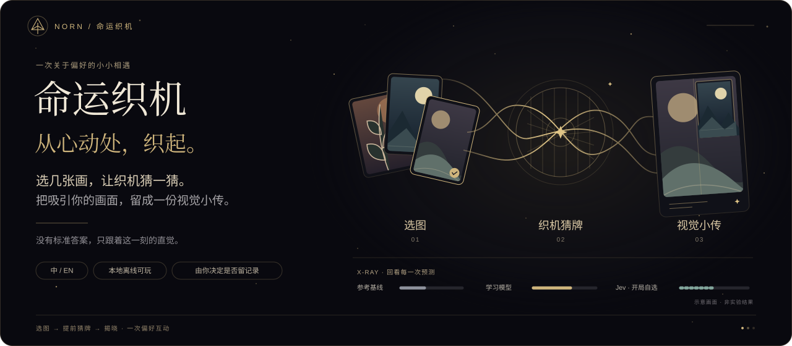
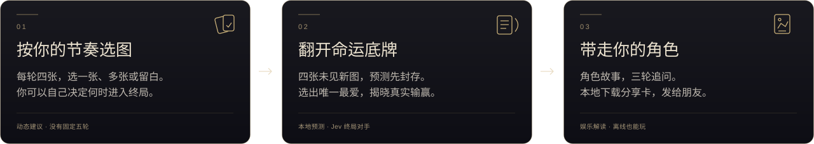
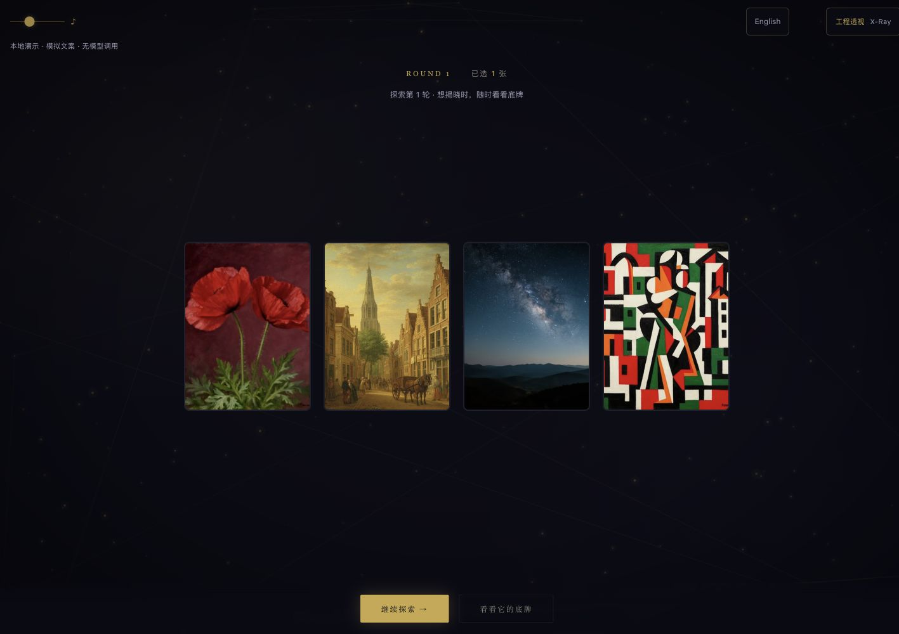
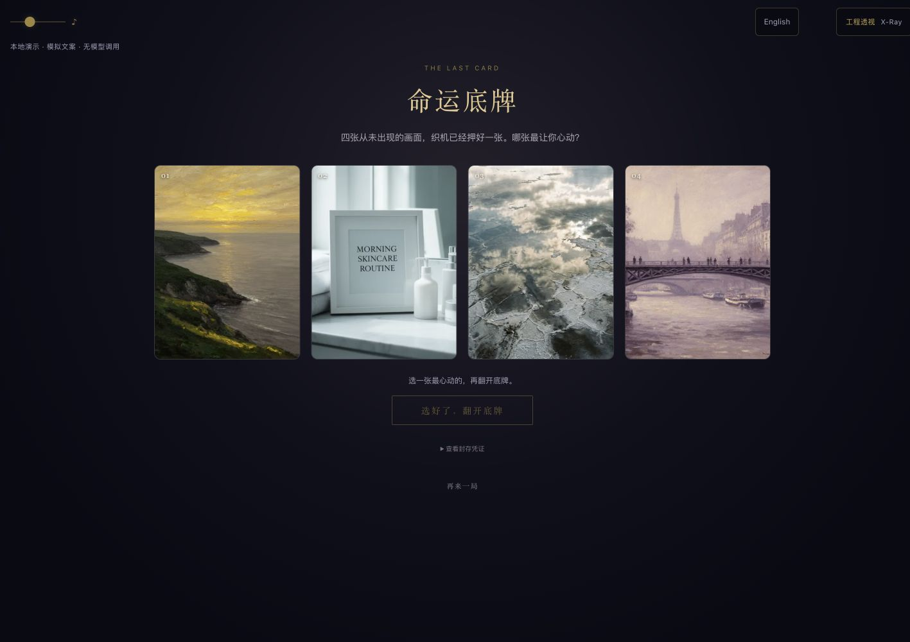
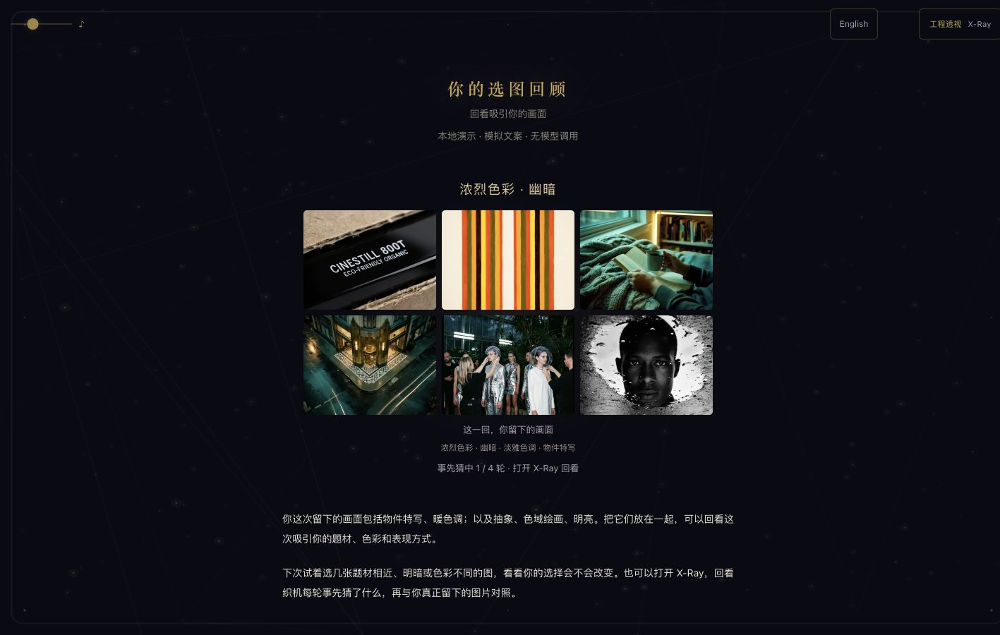
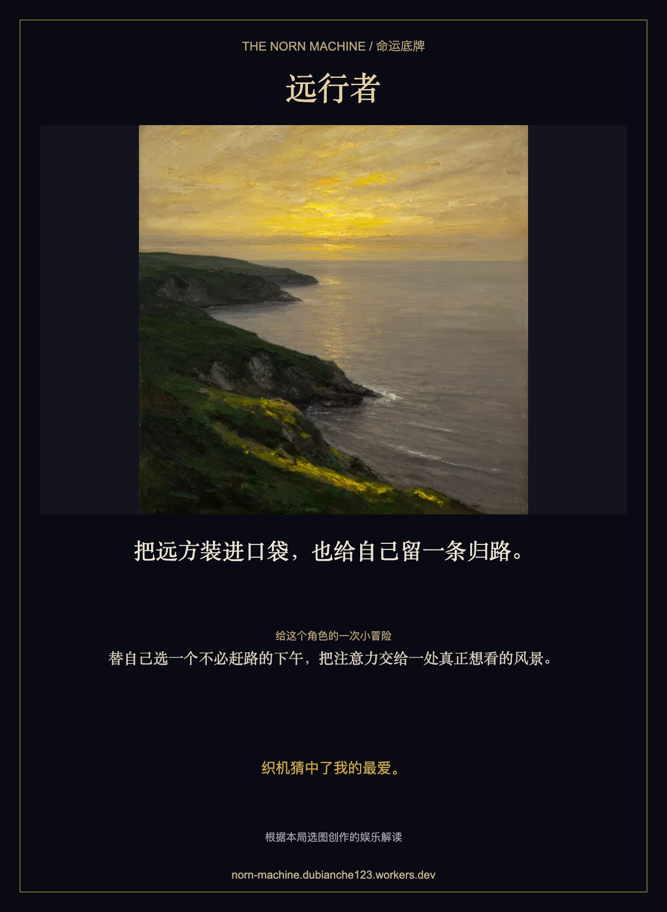
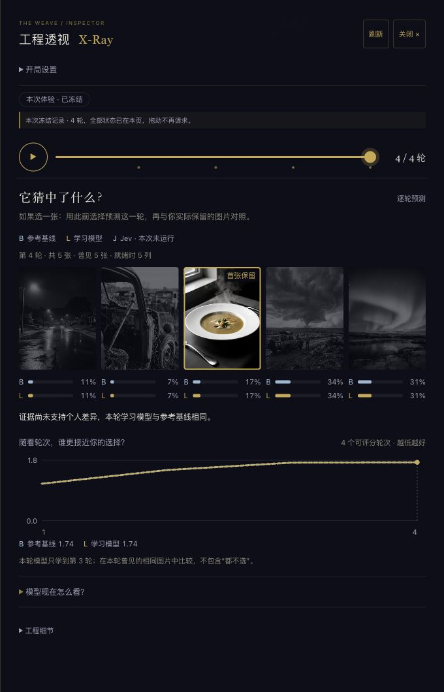
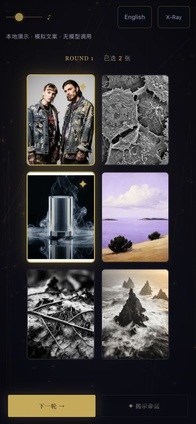
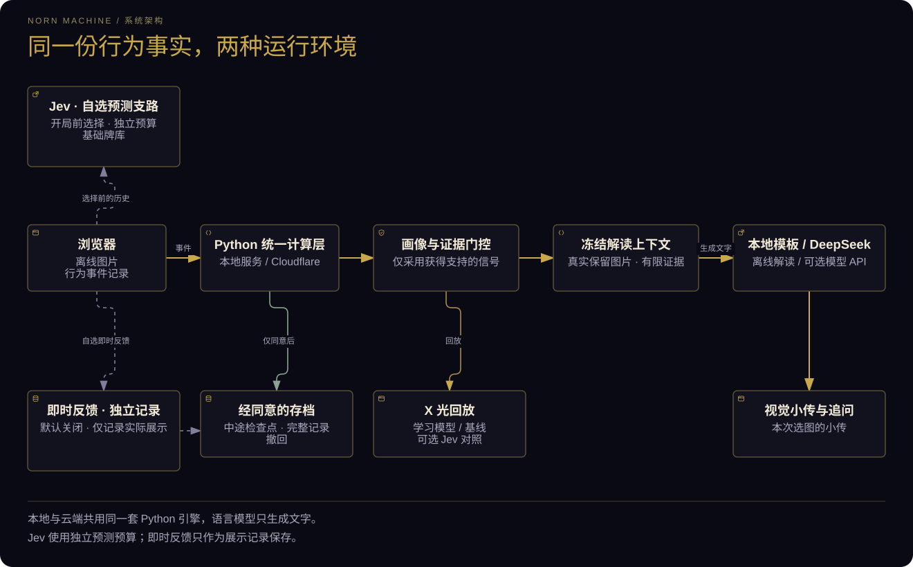

<div align="center">

# The Norn Machine · 命运织机

**选你心动的图，看看织机敢押哪一张。**

[](https://github.com/dubianche123/norn-context-engineering/actions/workflows/ci.yml)
[](pyproject.toml)
[](LICENSE)
[](https://norn-machine.dubianche123.workers.dev/)
[](#本地运行)

### [在线体验 →](https://norn-machine.dubianche123.workers.dev/) · [本地运行 →](#本地运行)

[简体中文](README_CN.md) · [English](README.md) · [系统架构](#系统架构) · [模型与牌库](docs/research-deck.md)



</div>

**命运底牌**是一场看图读心的娱乐游戏。先跟随直觉选图，再从四张本局从未见过的图片里选出最爱。织机已经封存了押注，等你翻牌。随后，带走一个由本次选择启发的角色、一段解读和一张可以分享的图片卡。

游戏跟着你的节奏走。每轮探索结束后，一项有版本的策略会建议继续或进入终局；玩过一轮，你也可以主动进入终局。一局只翻一次底牌，想继续就重新开一局。这里没有固定五轮的测验，也不把某个选图数量说成“已经懂你”的门槛。

## 来翻一张底牌

<p align="center">
  
</p>

**1 / 跟随直觉。** 每轮四张图，选一张、多张，或全部留白，也可以撤回、改选。节奏提示是一项邀请，你也能自己决定何时进入终局。

<p align="center">
  
</p>

**2 / 看织机敢押哪张。** 服务端先封存预测，再展示四张新图。选出其中最心动的一张，翻开织机的底牌。猜中就兑现惊喜，猜错也照实留下。

<p align="center">
  
</p>

**3 / 见到你的角色。** 最爱图成为角色卡的主图，配上角色名、分享句和具体解读。你可以继续追问三轮，再下载一张浏览器本地生成的 PNG 发给朋友。保存卡片不会上传图片。

<p align="center">
  
</p>

角色名与故事是本局图片启发的娱乐创作，不是学习模型得出的心理测量分类。真实竞猜结果另外展示，也可以独立核对。

<details>
<summary>带走一张角色卡</summary>
<p>下载的卡片带着你的最爱图、角色、一项小邀请和真实竞猜结果。图片在本地生成；要不要发给朋友，由你决定。</p>
<p align="center">
  
</p>
</details>

<details>
<summary>打开 X-Ray，看看幕后</summary>
<p>拖动时间轴回看真实选择和事前预测。学习模型回退到参考基线时，会明确说明；相同的输出不会被包装成两份独立证据。</p>
<p align="center">
  
</p>
</details>

<details>
<summary>手机上也能玩</summary>
<p align="center">
  
</p>
</details>

中英文界面分别实拍。使用本地模拟时，拟合、节奏、封存竞猜与回放都执行真实代码，文字明确标注为模板解读；配图展示界面，不代表真人研究结果。

## 玩什么、留什么，由你决定

无论是否贡献数据，都能获得相同的完整游戏、角色、追问和分享卡。匿名贡献是独立、自愿、可撤回的选择。同意后，中途离开的探索也会尽量保存，包括最后一轮的真实点选和临时停留信息；完成后用完整记录替换同一次访问的中途存档。浏览器突然退出仍可能阻止最后一次尽力保存。

**Jev 是独立的终局对手。** 服务端可用时，命运底牌开局前默认加入 Jev，你可以在那里关闭。每局最多只在终局发起一次付费预测，不在每轮探索中调用。此前选择和候选数值特征会发送给 Typesafe，开局前会说明；没有配置密钥或没有有效结果时，不会编造对手成绩。逐轮本地反馈另有开局开关，默认关闭。详见[完整玩法与资源约定](docs/last-card.md)。

## 本地运行

需要 **Python 3.12+**，在仓库根目录运行：

```bash
python3 -m norn doctor
python3 -m norn serve --mock
```

打开 [localhost:8765](http://127.0.0.1:8765)，端口冲突可加 `--port 8766`。PAM∃LA 的全部 256 张 WebP 图片、数值特征和前端资源都随仓库提供。本地模拟无需 AWS、API Key、联网或额外 Python 运行库。

`--mock` 用离线创作模板替代语言生成；模型拟合、节奏决定、服务端封存、真实输赢和 X-Ray 仍实际运行。线上配置 DeepSeek 后生成实时解读。早期牌库仍可显式用 `--deck classic` 打开。

## 系统架构

<p align="center">
  
</p>

本地服务与 Cloudflare Worker 共用 Python 事件校验与 v6 模型。模型预测图片选择，独立且有版本的创作上下文负责让本地模板或大模型写出角色故事。终局最爱不会悄悄回灌进已经作出押注的探索模型。

| 部分 | 职责 |
| --- | --- |
| 探索与 v6 | 真实选择日志、小样本收缩、证据门控及可加总贡献账本。 |
| 节奏策略 | 根据已完成历史给建议，记录发出建议的概率；首版是探索性策略，**尚未训练**。 |
| 封存终局 | 四张此前未见图、服务端隐藏押注、不可改写的最爱选择和可核对的翻牌。 |
| 创作解读 | 角色母题、具体画面依据、三轮追问与本地分享卡。 |
| X-Ray | 真实回放、模型边界、参考回退，以及及时返回的 Jev 对照。 |
| 可选归档 | 有版本的产品／节奏／终局附录，中途存档，同意与撤回。 |

**研究的问题：** 系统能否从少量、自愿的游戏选择中学到有用偏好？什么时候再多一轮探索值得付出时间？有趣的终局能否与可核对的预测证据并存？产品提供同一套完整体验，研究按其有版本的观察进行分析。论文数据集、实验与原始研究结果继续留在独立的本地研究工作区；本 README 说明研究问题，不展示实验效果数字。

当前产品记录进入独立的 `.last-card.v1` 分群；开启逐轮反馈时再加 `.round-feedback.v1`。新流程不会悄悄混入旧冻结访客协议。详见[测量](docs/measurement.md)、[X-Ray](docs/xray.md)和[牌库与模型](docs/research-deck.md)。

## 实时解读与部署

本地接入明确选择的兼容模型接口：

```bash
export NORN_BASE_URL='http://127.0.0.1:8000/v1'
export NORN_MODEL='your-model-name'
python3 -m norn serve --provider openai-compatible
```

接口需要鉴权时设置 `NORN_API_KEY`。线上解读使用 DeepSeek 官方接口，密钥只在服务端；Jev 使用独立的服务端密钥与额度。Cloudflare Workers 提供静态资源和同源 API，隔离的 Durable Objects 保存临时游戏／对话状态、共享预算与经同意的归档。[部署文档](docs/deployment.md)另有其他模型和 Docker 方式。

## 验证与代码入口

```bash
python3 -m pip install '.[dev]'
python3 -m pytest
git diff --check
```

测试覆盖确定性回放、真实前缀节奏决定、隐藏封存、不可改写的最爱、actor 恢复、双语角色生成、同意与分群边界、响应式界面。工程检查不等于人格准确率或真人推荐收益的证明。

| 从这里开始 | 内容 |
| --- | --- |
| [完整玩法](docs/last-card.md) | 产品闭环、节奏、封存竞猜、Jev 额度和分享。 |
| [牌库与 v6](docs/research-deck.md) | 参考评分、视觉特征、证据门控与出牌。 |
| [测量](docs/measurement.md) | 预测、产品体验和娱乐解读分别怎样解释。 |
| [节奏策略评估](docs/pacing.md) | 按访客留出的离线报告，以及不能自行上线的候选策略。 |
| [X-Ray](docs/xray.md) | 共同候选、回退、及时预测与回放。 |
| [前端](the-norn-machine/frontend/) · [服务](norn/service.py) | 交互阶段和共用权威 API。 |
| [采集](norn/collection.py) · [Cloudflare](cloudflare/) | 中途存档、撤回及托管适配。 |

PAM∃LA 图片采用 **CC BY 4.0**（[来源与署名](the-norn-machine/frontend/assets/decks/pamela-v1/ATTRIBUTION.md)），代码采用 [MIT 许可](LICENSE)。
