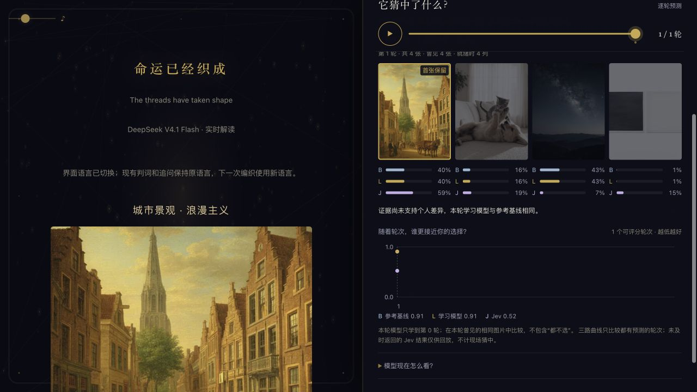
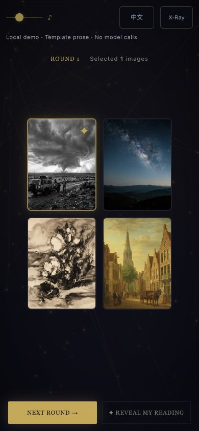
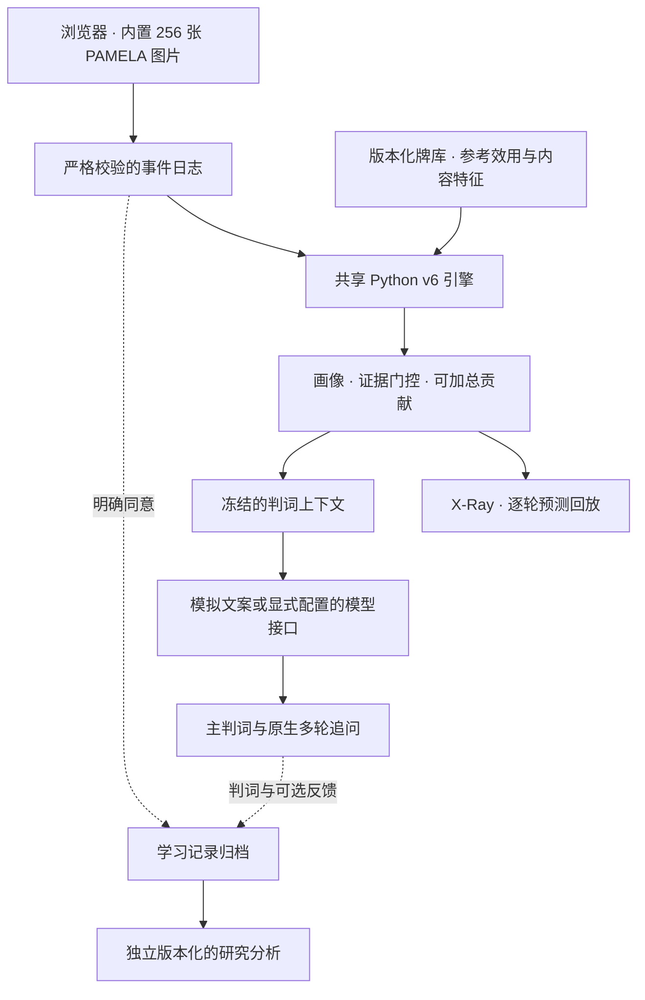

<div align="center">

# The Norn Machine · 命运织机


[在线体验](https://norn-machine.dubianche123.workers.dev/) · [本地运行](#本地运行) · [系统架构](#系统架构) · [模型与牌库](docs/research-deck.md) · [English](README.md) · [MIT 许可](LICENSE)

</div>

**命运织机（The Norn Machine）** 是一场关于视觉偏好的猜牌互动：**只靠几轮选图，模型能不能慢慢猜中你下一张会被什么吸引？** 每轮你可以留下几张、全留或一张不选；随时停下时，系统会用你实际保留的画面生成一份视觉小传，回顾每轮事先锁定的猜牌命中情况，并开放追问对话。

在底层，Norn 严格拆开了两类工作：**确定性的 Python 代码掌管事件账本、序贯偏好拟合与统计证据门控；语言模型只根据冻结的上下文把结果写成判词。** 选图、拟合、回放与模拟判词全部支持零依赖离线运行。

<p align="center">
  
  <br /><sub>真实界面 · 保留的画面组成视觉小传，拖动 X-Ray 时间轴可回看每轮事前预测。</sub>
</p>

<details>
<summary>看看英文手机界面</summary>
<p align="center">
  
</p>
</details>

**核心研究问题：** 当反馈极少、访客随时可能离开时，系统什么时候有把握开始个性化？什么时候应该承认信号不足、主动克制？下一轮展示什么画面，才能兼顾当下的正反馈与学习效率？Norn 既是对外开放的互动体验，也是经明确同意后收集真实交互观察的研究工具；离线数据集、模拟实验与论文分析维护在独立的本地研究仓库中。

## 本地运行

需要 **Python 3.10+**。在仓库根目录执行：

```bash
python3 -m norn doctor
python3 -m norn serve --mock
```

浏览器打开 [localhost:8765](http://127.0.0.1:8765)（端口冲突可加 `--port 8766`）。项目已内置 PAM∃LA 牌库的全部 256 张 WebP 图片（`--deck pamela-v1`）、视觉特征与前端资源，克隆后无需联网、云账号或第三方 Python 运行库即可完整体验。

**`--mock` 仅替换大模型的文字渲染。** 事件校验、v6 序贯拟合、证据门控、可加总贡献账本与 X-Ray 透视面板全部执行真实代码。也可以通过 `python3 -m pip install .` 安装命令入口，或使用 `--deck classic` 体验早期自制牌库。

## 核心体验与功能

- **事前锁定的猜牌与视觉小传。** 支持自由选图、撤回与改选。每轮发牌时，引擎仅凭此前已完成的轮次预先锁定本轮头号猜测；结束时揭晓由实选画面组成的视觉小传、猜牌命中回顾，以及最多三轮追问。
- **双入口设计与可控的数据边界。** *“织入命运”* 自愿贡献匿名研究记录（支持随时一键撤回单条或当前浏览器的全部记录）；*私密入口* 不留任何研究归档。两个入口提供完全一致的小传揭晓与猜牌回顾。
- **交互式 X-Ray 预测回放。** 拖动时间轴，逐轮对照参考基线概率、个人学习模型预测、你的真实选择与累计预测损失。为避免提示干扰直觉，预测反馈默认在结束选图后统一解锁。
- **开局前可选开关（逐轮反馈 & Jev 对照）。** 开局前展开 X-Ray，可按需勾选“边玩边看每轮预测反馈”，或开启 **Jev**（通过 Typesafe 调用 `jev-1.13.0`）进行三轨预测对照。两个开关相互独立，默认关闭，开局发牌后锁定。详见 [X-Ray 设计说明](docs/xray.md)。
- **双语切换与自适应网格。** 自动识别浏览器中英文偏好并记忆手动切换；4–6 张图在手机、平板、桌面与分栏视图下自动排布为均衡的多行网格。
- **可独立核验的会话导出。** 一键导出事件日志、冻结画像与分数贡献账本 JSON，既可重新导入 X-Ray 查看，也能在命令行离线复核：

```bash
python3 -m norn replay /path/to/norn-recording.json --json
```

> **关于跨环境重放校验：** v6 引擎使用 `native-libm` 浮点运算。由于本地 CPython 与 Cloudflare Workers（Pyodide/WASM）底层数学库的末位舍入存在细微差异，从线上导出的记录建议直接导回线上 X-Ray 进行逐位哈希核验。

## 系统架构



本地服务与 Cloudflare Python Worker 共享同一套 Python 模型与事件校验实现。

### 1. 三层嵌套序贯偏好模型（`v6`）

牌库中的每张图片带有由真人评分构建的参考效用 `u`，以及 8 维内容特征 `x8`。面对极小样本，v6 不直接硬拟合高维参数，而是逐层评估三个嵌套解释：

| 层次 | 图片效用 | 表达含义 |
| --- | --- | --- |
| **参考基线（`L0`）** | `u` | 数据集评分人群对这批图片的基线偏好。 |
| **口味敏感度（`L1`）** | `a × u` | 本次访问更贴近、较少跟随、还是反向于大众参考方向。 |
| **个人偏离（`L2`）** | `a × u + x8 · δ` | 超出大众喜好方向的特定内容与风格偏好。 |

序贯选择模型同时对“在剩余可见卡片中选哪张”与“何时停下”建模，并用小样本收缩先验抑制过拟合。每轮开始前的前瞻预测不断积累序贯证据，只有跨过对应的**证据门控（evidence gate）**，系统才会启用更深一层的个性化解释。当轮数太少、不足以区分个人偏离与随机波动时，模型判词会克制地停留在已有证据支持的层次，而主界面依然用访客真实保留的图片生成视觉小传。详见[牌库、模型与出牌契约](docs/research-deck.md)。

### 2. 兼顾正反馈与学习的混合出牌

如果每轮只推高分预测图，选中率虽高，但模型缺少对比信号、学不到偏离；纯随机发牌利于学习，却容易让人觉得“它不懂我”。Norn 将每次会话随机分入随机出牌或**混合出牌（Mixed Dealing）**——将个人候选推荐与一热一冷的参考对比图组合，并随机打乱屏幕位置。每张卡的出牌策略、牌库版本与角色均写入事件日志，便于事后复盘。

### 3. 冻结上下文与隐私友好的研究归档

结束选图后，Python 将实选图片与通过门控的模型层次打包为带版本号与哈希的冻结上下文，供主判词和后续追问共享；大模型不修改学习权重，也不会把未展示的图片当成被拒绝的选项。

仅在访客明确选择“织入命运”时，系统才会归档事件日志（含针对未完成轮次的轻量非阻塞检查点，以便在不伪造结束事件的前提下分析自然流失）、实验分组与关联当前浏览器的随机匿名标识，并支持随时撤回。归档绝不采集 IP、User-Agent 或追问对话内容。

## 模型接口与 Cloudflare 部署

本地运行默认使用 `--mock`。如需接入本地或远端 OpenAI 兼容接口生成真实判词：

```bash
export NORN_BASE_URL='http://127.0.0.1:8000/v1'
export NORN_MODEL='your-model-name'
python3 -m norn serve --provider openai-compatible
```

若接口需要鉴权，在环境变量中设置 `NORN_API_KEY` 即可。Anthropic、Gemini、Amazon Bedrock 与 Docker 部署方式见[部署文档](docs/deployment.md)。

线上环境运行在 Cloudflare Workers（`norn-machine`）：

| 组件 | 职责 |
| --- | --- |
| **Static Assets + Python Worker** | 前端静态资源、256 张 WebP 牌库图片与同源 API 路由。 |
| **`NornSession`（SQLite Durable Object）** | 浏览器隔离的会话状态、冻结对话上下文与幂等请求回执。 |
| **`NornBudget`（SQLite Durable Object）** | 跨会话的模型调用与并发准入控制。 |
| **`NornArchive`（SQLite Durable Object）** | 经同意的研究记录、中途检查点、体验分群路由与撤回。 |
| **DeepSeek 官方接口（`deepseek-flash`）** | 服务端持有密钥，负责低延迟双语判词生成。 |

## 测试验证与代码导航

```bash
python3 -m pip install '.[dev]'
python3 -m pytest
git diff --check
```

工程测试集（约 760 项测试、1,300+ 子测试）覆盖事件准入校验、PAM∃LA 牌库契约、v6 序贯拟合、证据门控、可加总贡献重建、冻结上下文、幂等请求恢复、归档分群隔离与前端响应式布局。

| 代码与文档入口 | 内容说明 |
| --- | --- |
| [docs/research-deck.md](docs/research-deck.md) | PAM∃LA 参考评分、内容特征、证据门控与混合出牌规则。 |
| [norn/events.py](norn/events.py) · [norn/service.py](norn/service.py) | 事实事件日志与判词、追问生命周期。 |
| [research_model.py](the-norn-machine/backend/research_model.py) · [research_deck.py](the-norn-machine/backend/research_deck.py) | 可移植 v6 序贯选择引擎、证据门控与冻结上下文组装。 |
| [the-norn-machine/frontend/](the-norn-machine/frontend/) | 选图画板、双语判词视图与交互式 X-Ray 时间轴。 |
| [norn/collection.py](norn/collection.py) · [cloudflare/](cloudflare/) | 自愿研究归档、中途离开检查点与 Durable Object 适配层。 |
| [docs/learning.md](docs/learning.md) · [docs/measurement.md](docs/measurement.md) · [docs/fast-thinker-comparison.md](docs/fast-thinker-comparison.md) | 早期模型演进（`v1`–`v5`）与离线评测工具。 |

PAM∃LA 牌库图片遵循 **CC BY 4.0** 协议（见[来源与署名](the-norn-machine/frontend/assets/decks/pamela-v1/ATTRIBUTION.md)）；项目代码采用 [MIT 许可证](LICENSE)。
