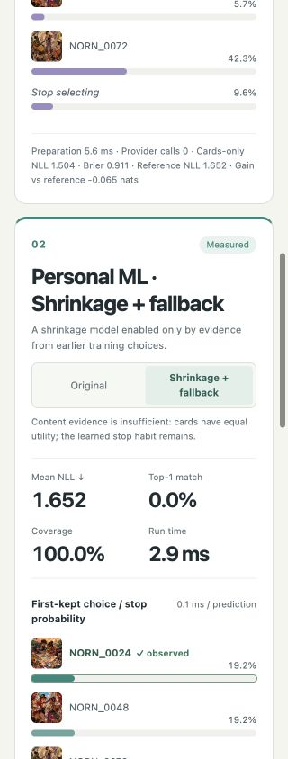

# Shrinkage and insufficient-signal fallback

Scoring/profile/preview **v5** is the local default. The Cloudflare pilot remains v4; this update made no remote model calls and performed no deployment. The [original losing report](../benchmarks/results/fast-thinker-comparison-fixture-20261021/index.html) is preserved. The [new comparison](../benchmarks/results/choice-policy-comparison-fixture-20261021/index.html) keeps its original ML lane and adds a switch for the guarded policy, with the same candidate images, labels, split and metric.

## Implemented behavior

`backend/choice_policy.py` wraps the unchanged v4 model with one fixed candidate and a training-only gate:

- Candidate weight precision is `1.5 * (1 + 12/max(1,n))`, where n counts completed rounds with eligible exposure. STOP precision remains .5. This strengthens the prior for short histories and tends to the original prior. The formula is a declared design choice, not a fitted optimum.
- Before each completed training round, the preceding candidate predicts its retained-card sequence, frozen throughout the round. Conditional-card likelihood relative to uniform accumulates in log space. STOP does not count as content evidence. There is no probability floor, reset, best-window selection or same-round refit.
- Only current `logE >= log(20)` activates card weights. Later counterevidence can close the gate. Otherwise card weights are exactly zero and the training-prefix stop-only estimator supplies STOP. No tied-card ID ranking is presented as a personalized recommendation.
- The raw candidate posterior is separate from effective parameters. Contributions, maps, recommendations, comparison probabilities and prose all follow effective parameters. While on baseline, X-Ray hides candidate ellipses and type guesses and displays a short bilingual insufficient-evidence message. Raw details remain collapsed.
- Open rounds can update a provisional candidate and STOP but never advance the gate. Historical v1–v4 profiles retain their original reconstruction. Versioned service instances also let the frozen prose/judge experiment keep its v4 facts and cache identities.

The [policy protocol](choice-policy-protocol.md) was fixed before evaluating this predictor. Its ideal-null threshold bound assumes conditionally uniform retained-card labels; it is not 95% confidence in human preference. Failure to pass is insufficient evidence, not proof of no taste. The gate cannot anticipate a future reversal absent from its training history.

## Same held-out data, including losses

Every one of the original **840 journal hashes matches**, covering seven mechanisms × 120 simulated visitors. Seeds 11/29/47, 40 rounds, prefixes 4/8/16/24/32 and the fixed final eight test rounds remain unchanged. Each policy is refitted and gated using only its supplied prefix. No hyperparameter or threshold was changed after seeing these outcomes. This already-inspected holdout is development regression, not independent human validation.

**First-kept / STOP NLL**, equal visitor weight, lower is better:

| Mechanism | Original ML, 8 rounds | Guarded, 8 | Original ML, 32 | Guarded, 32 | Active at 32 |
| --- | ---: | ---: | ---: | ---: | ---: |
| No content taste | 2.032 | 1.827 | 1.903 | 1.827 | 0/120 |
| Always first slot | 2.440 | 2.166 | 2.346 | 2.219 | 0/120 |
| Stable 64-column pixel taste | 1.841 | 1.815 | 1.690 | 1.722 | 77/120 |
| Sparse motif taste | 2.038 | 1.798 | 1.865 | 1.794 | 0/120 |
| Pixel taste reversed after training | 2.575 | 1.908 | 2.644 | 2.396 | 77/120 |
| Own features + logit, circular control | 1.242 | 1.485 | 1.069 | 1.072 | 120/120 |
| Own features + threshold process | 1.623 | 1.661 | 1.535 | 1.524 | 119/120 |

The safety improvement has a cost. On no-content data, the eight-round penalty relative to stop-only falls from +.205 to exactly zero, and the 32-round penalty from +.076 to zero. Sparse motif data similarly falls back rather than claiming an image preference. There is one active visitor at prefix16 in each of the null/position cells; the gate later closes. It is not a claim of zero possible false activation.

On stable pixel data at32, guarded still beats rules (1.772) and stop-only (1.813), but is **worse than original ML by .032 nats**; the paired descriptive 95% interval is [.003, .062]. The conservative gate sacrifices some real weak signal. The same-family control also loses early power: 8-round original1.242 becomes1.485. The threshold-response bridge improves slightly at32, but its full-sequence difference is essentially zero. No universal superiority is claimed.

Reversal remains a failure. Stable pixel and reversal have identical training prefixes, hence identical gates: 77/120 are active at32. Guarded reversal NLL2.396 is still much worse than stop-only1.814. Training-only gating cannot detect an unseen future sign change. Sparse motif fallback does not solve missing representation either.

The original 8/16 demonstration split also remains unchanged. Original ML **2.3147**, rule **1.7162**, guarded **1.6516**. Guarded is exactly stop-only because training log evidence **0.4045 < log20**. Uniform is still **1.3863**. Full sequential NLL is original ML1.5739, rule1.5678, guarded/stop-only1.1475. The fallback terminal policy is declared stop-only; it does not inspect test scores to pick whichever baseline wins.

All metrics, denominators, paired pointwise intervals, guard states, candidate/effective parameters and source/protocol identities are in the [readable summary](../benchmarks/results/choice-policy-validation-20261021-summary.json) and [compressed per-visitor results](../benchmarks/results/choice-policy-validation-20261021.json.gz). Intervals are uncorrected and simulated-only. Full diagnostic sequences exclude forced STOP; production validation retains the older engine denominator including those zero-loss steps, explicitly labeled.

## Reproduce and inspect

```bash
# Same exact saved input identities; new output only, no account or API.
python3 scripts/validate_choice_policy.py --output /tmp/choice-policy-new.json.gz

# New/old interactive switch, default offline; leave the original report alone.
python3 -m norn compare --fixture --train-rounds 8 \
  --output /tmp/choice-policy-compare-new.json --html /tmp/choice-policy-compare-new.html
```

`records evaluate` adds `hybrid_guarded` without relabeling old `hybrid` or changing its bootstrap stream, selection rules or new-image protocol. `records report` remains the explicit raw v4 reference. Existing paid prose/judge experiments are pinned to v4 for both generation and fact reconstruction, preserving all six stored fact hashes and twelve judge cache keys.

Tests cover strict v4 profile/context preservation, v5 replay and rehashed-tamper rejection, independent concurrent versioned services, conditional evidence ordering, gate closure, no-exposure/STOP/forced/open handling, exact baseline probabilities, effective contribution reconstruction, unchanged original ML, held-out isolation, and bilingual UI switching. A complete run recorded 597 passed plus one newly added test whose snapshot input omitted required fields; that test input was corrected and its isolated recheck passed. Nineteen optional-dependency tests were skipped; 1,210 subtests passed in the complete run. The earlier sandbox run's localhost binding errors were rerun with local test-port permission, not skipped or marked passed.

The separate [runtime/package probe](../benchmarks/results/choice-policy-runtime-20261021.json) uses one frozen source snapshot with no network or optional ML dependency. CPython3.14.8 and real Pyodide314.0.6/Python3.14.2 reproduce the entire portable baseline8/active32 states and trajectories exactly; the v5 profile/export hash matches across runtimes and old v4 golden remains unchanged. Native-math deviations are at most `3.33e-16`. A fresh wheel installed into an isolated environment ships the exact policy bytes, passes doctor/v5 service preview and verifies all256 offline images. This is local runtime/package acceptance, not a deployed Worker test. Final affected tests also passed **61 cases and 56 subtests**, overlapping the complete run.

The added prefix fits increase computation; one native-host CPython run of a 32-round portable path took about .84 s while other tests were running. This is a local observation, not a Worker latency/CPU result. Reusing `path` states avoids refitting the same prefix for each comparison cutoff, but exact batch MAP refits still have growing total cost. Fresh human holdout and the unchanged new-image pilot remain necessary before claiming real preference benefit or changing features/thresholds again.


