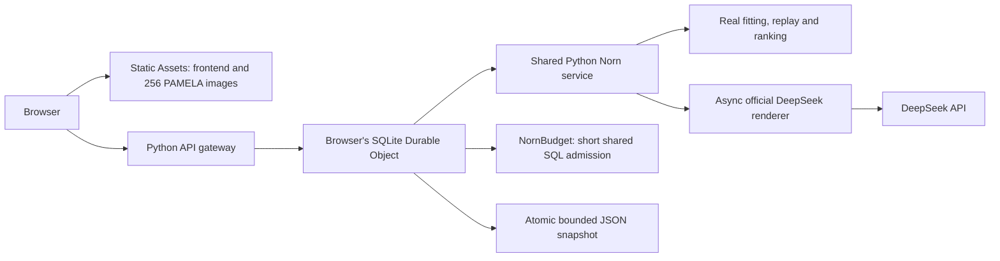

# Portable deployment

Norn 0.8 uses one authoritative Python implementation for local execution and Cloudflare Python Workers. The current main build ships the PAM∃LA deck (256 bundled WebP images), v6 preference fitting, versioned replay, contributions and X-Ray. Local execution defaults to an offline, key-free mock renderer. The hosted configuration uses official DeepSeek V4.1 Flash (`deepseek-flash`) for prose through a server-held secret, with SQLite Durable Objects owning sessions and paid-call admission.

## Cloudflare Python Workers

**Public address:** [norn-machine.dubianche123.workers.dev](https://norn-machine.dubianche123.workers.dev). The PAM∃LA/v6 upgrade uses the existing `cloudflare/` project and `norn-machine` Worker. It keeps the public URL, session/archive bindings, shared budget and DeepSeek route. No real legacy users require a conversation migration, and there is no second public research product.

**Published 2026-10-22:** `3b7045f9-c186-441f-aca5-9fb87e984040` shipped open-round choice/attention checkpoints, guessing recaps, visual portraits and pre-entry live Jev. [Hosted archive acceptance](../benchmarks/results/norn-active-round-live-20261022.json) passed 28 checks with zero model calls and confirmed cleanup. Separate bounded live checks succeeded with one Jev call and one DeepSeek call; those are not part of the zero-model archive run.

**Current release (`dbce9b2d-f3be-40cf-81fc-4357b2386909`):** round feedback is a separate default-off pre-entry switch under either archive choice, with settings and actual exposure saved in an experience sidecar. This also fixes the mobile feedback layout. [Final hosted acceptance](../benchmarks/results/norn-partial-visit-live-v4-20261022.json) passed 37/37 checks with zero model calls and confirmed test-record cleanup. [Browser observations](../benchmarks/results/norn-play1-browser-20261022.json) separate the earlier one Jev / one DeepSeek integration run from these zero-model checks. The first deployment's evidence remains valid for its stated scope.

**Previous published release 2026-10-22:** version `6ba425e2-a5cd-4da4-a492-537079da6496` adds consent-v4 partial visits and keeps the optional slot layer dormant. The [hosted archive acceptance](../benchmarks/results/norn-partial-visit-live-20261022.json) passed 22 checks: prefix ordering, two-tab visit numbering, in-place empty-reading completion, late writes after single/all withdrawal, and cleanup of only the test visitor. The empty-reading path called no model. [X-Ray regression](../benchmarks/results/norn-xray-consent4-live-20261022.json) passed 23 checks, and [four changed public assets](../benchmarks/results/norn-consent4-assets-20261022.json) match the bundle. Both stored secrets remain available: health is ready and the operator export authenticated. Earlier DeepSeek generation and X-Ray releases below retain their original version scopes; that release made zero new DeepSeek/Jev calls.

The browser's `deck: "pamela-v1"` and the Worker's `NORN_DECK=pamela-v1` must change together. The main bundle command selects that deck by default. `--deployment research` is an optional isolated build target; it is not needed for the public Norn upgrade. See [the current deck contract](research-deck.md).

Cloudflare hosting remains on its free plan, subject to platform limits. **DeepSeek is a paid external model route and consumes the operator's model balance.** Visitors do not enter credentials. `NORN_API_KEY` is an encrypted Cloudflare secret read only by the outbound transport; it is absent from frontend assets, SQLite snapshots/receipts, replay exports, and application logs. Frozen profile evidence and dialogue messages go to the official DeepSeek endpoint when rendering is requested. No AWS resource or account is needed.

### Request and state ownership



The gateway checks same-origin requests and forwards their request stream by RPC; event parsing, replay, preference training, and session work run inside the browser's `NornSession` Durable Object. Static Assets handles ordinary frontend/image requests without invoking that Python API path. A separate `NornBudget` object performs only short global quota transactions; it does not collect visitor conversations or hold their prompts/keys. The shared Python service prepares and settles the result around one awaited model request, keeping fitting and scoring in one authority.

`GET /api/health` establishes a random `__Host-norn-actor` cookie before interactive API requests start. It is `HttpOnly`, `Secure`, `SameSite=Strict`, scoped to `/`, with `Max-Age=1800` renewed by API activity. This renews only the routing capability: persisted session and receipt expiries remain absolute and unchanged. The cookie selects an isolated actor; it is a temporary browser capability, not an authenticated personal account. Clearing it or using another browser loses access to that actor's reading. Do not copy or log it.

Each actor keeps **one current reading**, up to three successful follow-ups under the existing round rules, and at most **40 durable paid-operation receipts**. A new successful analysis replaces its previous reading. Actor v2 snapshots freeze the nonsecret generation route along with profile/context, native dialogue history, absolute epoch expiries, and model-attempt count; the API key is never part of this state. Existing actor-v1 sessions retain their mock renderer and can finish under that contract. A live session never silently changes renderer when configuration changes.

The adapter validates detached JSON and stores bounded snapshots in SQLite chunks. For a paid request, it first commits a `pending` receipt, then atomically reserves global quota, then persists the browser attempt counter before sending HTTP. The completed result receipt and updated conversation snapshot settle in the **same synchronous SQLite transaction**. A storage failure leaves the prior conversation and pending operation available for conservative recovery, rather than exposing an unpersisted successful turn. Locks and in-flight request objects are not serialized. State is capped at **16 MiB** and browser API request bodies at **8 MiB**.

Session expiry remains 30 minutes from creation; restoring an actor never refreshes that timestamp. Cleanup alarms prune expired sessions and receipts. Isolate eviction can recover an unexpired conversation from SQLite. Conversation state and optional Jev capabilities/receipts are temporary; the durable, cross-visitor behavior archive is the consented record archive described next. Downloads remain the user-owned replay artifact; exact derived replay still requires the compatible numerical runtime described below.

The current browser interaction stays in page memory. Backend continuity covers requests carrying the same routing cookie and session ID; it does not restore the selection UI or conversation screen after a page refresh.

Preview and replay use detached services and do not persist or mutate an active conversation. Current-deck X-Ray loads `norn.research-trajectory.v1` once, then switches completed-round states locally. `POST /api/preview` with `compact: true` and `GET /api/sessions/<id>/inspect?compact=1` return `norn.research-inspection.compact.v1`: the research profile and evidence gates plus a ledger summary (including nine weights), without the journal, context, prompt or all-card contribution rows. A full inspection retains those fields. Export always includes the complete ledger; compact chart transport never truncates the replay artifact.

The trajectory's prediction comparison reuses each preceding fitted state; it adds no model fits or external decision calls. Both entry options default to unlocking prediction hints after choices are sealed. A separate pre-entry, default-off feedback switch controls completed-round feedback while playing, independently of archive consent or Jev. An imported `{journal, comparison_report}` envelope validates and returns a separate whole frozen-prefix comparison. It never mixes its Jev lane with rolling predictions. Record binding and report integrity are checked, while a claimed remote call is not authenticated. See [X-Ray](xray.md) for the conditional target and exposure limitations.

Each current-deck visit also commits local guesses from the just-dealt prefix before interactions. Both entry options receive the final visual portrait and guessing recap; neither automatically shows round-by-round feedback. Only the explicit pre-entry feedback switch enables it, and the switch locks at entry. A unique top forecast must arrive before any current-round choice to earn live credit. The target is the first finally-kept picture; ties, late/missing forecasts and no-pick rounds are unscored. These local preview fits are separate from trajectory rendering. The portrait uses finally-kept images and observed motifs even when the model evidence gate declines personalization. Neither the portrait nor the game score is a personality diagnosis or an accuracy study.

The ledger has its own hash bound to the original profile and event hash. It explains the frozen v6 result without changing its arithmetic or profile identity. The trajectory is a display projection; its charts do not imply a cross-runtime exact-hash guarantee.

### Consented anonymous records

The welcome screen asks once, as part of entering: **织入命运** contributes this visit's learning record; **只看看，不留学习记录** opts out of that archive. Both start the experience and the music with the same tap. "留下的是什么？" expands the exact scope. The active hosted session still lasts up to 30 minutes under either choice. A learning record requires the exact consent version (`"consent": "norn.consent.v4"`) plus the browser's visitor key; any other consent value is rejected rather than treated as yes or no. Consent v4 (2026-10-22) adds one sentence to v3: if a visitor leaves before the reveal, the rounds they played are still saved.

**Visitor link.** On the first consented visit the browser creates a random 24-byte key and keeps it in `localStorage` (`norn.visitor.v1`). The server stores only `visitor_id`, the first 128 bits of its SHA-256, and numbers that browser's records `visit` 1, 2, 3… inside the write. The link connects visits from one browser so that learning and measurement can see the same person again; it is not an identity, there is no login, and "只看看" neither creates nor sends the key. Clearing site data starts a new, unlinked visitor.

A record (`norn.record.v2`) holds the sealed event journal, `visitor_id`, `visit`, coarse UTC day, consent/app/profile/scoring/prompt versions and hashes, any experiment arms, the generated reading, generation provider/model, and later two optional annotations: the post-reading rating and the number of follow-up turns used (never their text). It never holds IP addresses, user agents, cookies, session IDs, the visitor key, or follow-up questions. The full derived profile is not stored: the journal is the learning fact and can be replayed by any later model.

**Visits without a reading (consent v4, current deck).** The browser sends
`POST /api/record/partial` with `{consent, visitor, session_key, journal, open_round?, experience?}`
without blocking interactions. It checkpoints at a new deal/readiness, debounces
selection/revision changes by 500 ms, samples visible active rounds every
10 seconds, and flushes on hiding or page exit. Exit requests use `keepalive`
only when the encoded payload is at most 60 KiB; larger payloads use an ordinary
background request. There is one latest queued snapshot, not an event backlog.
Delivery remains best-effort under termination, network loss or browser limits.

The server validates a non-complete journal and writes a `norn.partial.v1` row
using the visit's random 32-hex `session_key` as `record_id`. The journal includes
real readiness, selection and deselection events from the current open round.
Optional `open_round` contains exactly `round`, `elapsed_ms`, `hidden_ms`,
`ready_offset_ms`, `seen_card_ids` and `hover`. It samples incomplete attention;
it does not seal picks or synthesize `round_completed` or STOP. Elapsed time is
from the deal; hidden time and hover offsets are from readiness. Readiness must
match the journal. Seen/hover can be null when unmeasured. An ongoing hover is
copied to the checkpoint endpoint without closing the browser's live interval.

A row advances only with the same event prefix or its genuine extension and
monotone attention. Older or same-length conflicting snapshots, erased prior
attention and rewind attempts are refused. A later real round completion must
cover its earlier samples. The partial keeps visitor/day/consent/app/deployment,
display/deck and journal facts, with no reading, profile or rating. It cannot
overwrite a full record or another visitor's row. A real reveal carries the
same `session_key` in the full record's `experiments` and upgrades that row in
place, preserving its visit number and annotations across multi-tab writes.
No archived partial may revive a completed or withdrawn row.

Exports contain both kinds. `norn records report` and `evaluate` skip partial
rows; `stats` counts them separately. Open choices/attention are not silently
converted into completed training targets. Without consent, or with collection
disabled, no background archive snapshot or archive identity is sent. Revealing
still sends the journal to the configured backend for the requested reading.
The visual portrait and guessing recap are available under either entry option.

**Withdrawal.** The key that links visits also authorizes deleting them. "撤回" on the reveal screen sends `{visitor, record_id}` to `POST /api/record/withdraw` and deletes that row if it belongs to this browser (403 otherwise). "全部撤回" inside "留下的是什么？" sends `{visitor, all: true}`, deletes every record of this browser (partial rows included) and forgets the key locally. Withdrawal also creates a domain-separated irreversible hash barrier: a record barrier for a single withdrawal, or an identity barrier for withdraw-all. It retains no behavior, original visitor key or original record identifier. Every later write checks these barriers in the same archive transaction, so in-flight requests from another tab cannot resurrect withdrawn content. After withdraw-all, a new explicit opt-in uses a new browser key. The page pauses collection as withdrawal begins and when another tab changes the stored identity; queued callbacks recheck that consent is still valid. An unknown withdrawal retains the key so it can be retried.

On Cloudflare, the actor queues record operations during the synchronous service call and applies them to one global `NornArchive` SQLite Durable Object (`records-v2`) before replying; for a paid reading this happens before the paid receipt settles, so a retried `request_id` replays the archive's real outcome. The reading is returned whatever happens to the record. An archive call that raises may have committed before its reply was lost, so it counts as unknown, not failed: every operation is idempotent (a repeated put of the same `record_id` writes nothing) and is retried once. A record write that is still unknown is withdrawn. Only a confirmed withdrawal, or a definite refusal from the archive, returns `record: null` ("这次没能保存记录"). If even the withdrawal cannot be confirmed, the reply keeps the receipt as `{record_id, unconfirmed: true}`. The page then says saving could not be confirmed and keeps "撤回", which succeeds whether or not the row exists. Each step is logged (`record.put`, `record.put_retracted`). The operator exports pages of NDJSON with a bearer secret:

```bash
npx wrangler secret put NORN_ARCHIVE_TOKEN --name norn-machine  # new deployments only; enter at prompt
curl -H "Authorization: Bearer $NORN_ARCHIVE_TOKEN" \
  "https://norn-machine.dubianche123.workers.dev/api/archive/export?limit=500"
# continue with &after=<last record_id> until an empty page
```

Without the secret the export route returns 404. Locally, records go to `$NORN_DATA_DIR` or `~/.norn/records.sqlite3` (`--data-dir`, or `--no-collect` to disable and hide the choice); `norn records stats`, `norn records export --output records.jsonl` and `norn records report` read them, and `norn records report --input export.jsonl` reads an archive export. An unusable data directory disables collection with a warning instead of stopping the server. See [measurement.md](measurement.md) for what the report computes.

**Current-deck experiment.** Each session is assigned random or mixed display-v2 dealing. Records carry `experiments.deck` and `experiments.display`; every displayed round names the deck hash and card roles. Consent v3 explains research use, randomized dealing and aggregate publication. The generated-image probe remains a historical route for the classic deck and is not included in the current main experience. Never combine journals from different decks as if they used the same stimulus or reference model.

### Live renderer and durable attempt limits

`norn/cloud_provider.py` calls only `https://api.deepseek.com/v1/chat/completions`, using model `deepseek-flash` and `thinking: {type: disabled}`. Fetch and complete response-body consumption share a **45-second deadline**. The encoded outbound JSON is capped at **32 KiB**, the received response at **2 MiB**, and the requested output at **1,600 tokens**; existing templates retain their smaller requested budgets, including the current 1,400-token reading budget. Oversized or invalid requests/responses fail explicitly. There are no hidden transport retries, alternate providers, or mock fallbacks. Only sanitized numeric usage counters and bounded provider identifiers cross the transport boundary.

`NornBudget` atomically admits at most **100 attempts per UTC day** and **four concurrent model calls**. Each admitted attempt gets a **120-second lease** so a crash cannot hold concurrency indefinitely. Releasing/expiring a lease never refunds its daily attempt; upstream failures also consume admitted attempts. These are call-count controls, not a monetary quote or a replacement for provider-side spending controls.

Each browser actor additionally permits **12 model attempts**. That count persists across eviction/redeployment and new readings; it resets only once all of that actor's temporary session/receipt records have expired and state is cleared. Sessions and paid receipts each have fixed 30-minute absolute expiries. Cookie activity does not extend those records. Existing round rules still allow one, two, or three successful follow-ups per reading, not 12 follow-up turns.

Analysis requires `request_id`; dialogue requires `turn_id`. Identical settled requests return their saved result without another model call; reusing an ID with different content returns 409. A pending operation has an uncertain outcome: the same ID returns **409 and is not dispatched again**, because the service cannot know whether the provider already billed it. After an explicit user decision to try again, use a new operation ID, which may consume another paid attempt. A quota-admission **429** occurs before upstream dispatch and can retry the same ID. Terminal upstream failures retain settled receipts and still count as attempts. No failure is silently presented as generated mock prose.

### Optional round feedback and experience metadata

Inside X-Ray, the round-feedback switch is off by default and can be selected
only before entry. Entry locks it for the visit. It applies under both archival
choices: private entry alone does not enable it, and Jev alone does not enable
it. Both entry paths still produce a full portrait and end-of-visit guessing
recap when feedback stays off.

Consented partial and full requests carry a separately validated experience
sidecar with the round-feedback setting and actual visible feedback exposures.
The `experience` object uses `norn.experience.v1`, `round_feedback` (`on` or
`off`) and `exposures`. Each exposure contains `after_round`, `feedback`
(`hit`, `miss`, `unscored` or `blank`) and entry-relative `elapsed_ms`. The browser
records at most one exposure per completed round after a visible animation
frame, with monotonically increasing rounds/time. Hidden pages, off-screen
feedback, sealed sessions
and a narrow-screen X-Ray covering the feedback do not count; this is a
rendering observation, not proof that the visitor read it. An eligible
prediction or attempted render is not itself a visible exposure.
This metadata stays outside the frozen event journal, v6 fitting and profile
hash. It must advance monotonically with the visit; completion preserves it
and withdrawal removes it with the archive row. Existing rows without the
sidecar remain readable, but missing data is not proof of no exposure.
Both partial and full builders route a new explicit-on record to
`deployment: "<source>.round-feedback.v1"` and retain its actual host in
`source_deployment`. Off and unspecified rows retain their existing
shape/deployment. Thus `deployment` now serves as a cohort-routing label;
`source_deployment` supplies the real host for the feedback cohort. Shared
archive SQL validates this routing and refuses on rows claiming an ordinary
host deployment or mismatched source/cohort fields. The raw behavior is kept
for a separately planned feedback study.

The unchanged frozen live-v3 reader does not inspect experience, but its
existing deployment gate excludes newly routed on rows as `other_deployment`.
Read-only verification accepted off/unspecified and rejected one current-builder
on row this way. Before routing, a same-deployment on row would be included;
this fix does not retroactively classify historical unknown records. Missing
sidecars remain unspecified, not confirmed-off. `classify_round_feedback` and
`filter_explicit_feedback_off` provide explicit classification/only-off
preprocessing with exclusion counts when an approved future protocol requires
it; they are not automatic eligibility changes. Self-selected opt-ins do not
identify causal feedback effects.

### Optional live Jev sidecar

Jev has a pre-entry X-Ray switch, off by default and locked once the visit starts.
It is independent of archive consent. The switch discloses transmission of
previous choices and numerical candidate features to Typesafe; no raw images,
current-round answers, future targets, reading or final profile are sent.
The separate round-feedback switch controls exposure during play; by default,
both entry paths wait until choices are sealed. Jev does not enable feedback.
Live Jev probability outputs stay in the page and are not added to the learning
archive; the round-feedback setting and actual feedback exposures are saved
separately when collection is enabled. The route's
`mode: "play"` names the prediction capability, not an archival opt-out.

`NORN_JEV_API_KEY` is an independent server-only encrypted secret. Without it
`GET /api/jev/status` reports unavailable and the local lanes still work. Local
`norn serve` accepts `NORN_JEV_API_KEY` or `TYPESAFE_API_KEY`; ordinary mock startup
requires neither. Use the secret prompt when explicitly configuring hosted Jev:

```bash
npx wrangler secret put NORN_JEV_API_KEY --name norn-machine
```

`POST /api/jev/start` creates an expiring capability with zero provider calls.
`POST /api/jev/predict` accepts only that capability and a just-dealt journal
prefix, under the same-origin actor boundary. Jev is pinned to `jev-1.13.0` and
the official Typesafe endpoint. Eight admitted prediction attempts across an
actor's active 30-minute capabilities, one in-flight request per actor, a
15-second full-response deadline and zero automatic retries bound the work.
The separate global `jev-play-v1` bucket permits 100 attempts per UTC day and
two concurrent calls; DeepSeek retains its own 100/day, four-call bucket above.
Settled repeated prefixes return cached receipts without another model call.
An unknown pending outcome is never redispatched. Quota, timeout or invalid
output leaves that lane unavailable while ordinary interactions continue.

Requests/results are temporary actor capability state, with absolute expiry;
they do not enter the durable research archive. Current-deck live comparison
uses only shared covered rounds for three-lane curves. Late predictions may be
replayed but get no live hit credit. Non-null slot-context decks are explicitly
refused until that input contract is designed. Opening, dragging or replaying
X-Ray adds no calls. Offline report import remains a distinct whole comparison
with one frozen training cutoff. See [X-Ray](xray.md) for its binding and
measurement limits.

### Build and deploy

Use the pinned `cf` CLI in `cloudflare/package.json`. Wrangler is the Python-module build implementation behind `cf`; `cloudflare/cloudflare.config.ts` is the project configuration, and `cloudflare/wrangler.config.ts` supplies its asset/build settings.

```bash
cd cloudflare
npm ci
npm run build
# Optional local Workers development server:
npm run dev
# Authenticate this CLI separately before your first CLI deployment:
npx cf auth login
# For a new deployment, enter the provider key at the secret prompt, not in argv:
npx wrangler secret put NORN_API_KEY --name norn-machine
npm run deploy
```

The Cloudflare MCP connection and the CLI have independent authentication. A successful MCP OAuth login does not authenticate `cf`. The 2026-10-21 release used the pinned `cf` CLI and the user's existing CLI authorization; no additional API token belongs in the repository.

The pinned cf CLI does not yet provide an equivalent single-secret prompt; its supported companion command above uses the installed Wrangler with an explicit Worker name. Do not echo, log, paste into a command argument, or commit the key. This deployment's encrypted secret has already been provisioned; a redeploy must preserve it. Runtime selection is `NORN_PROVIDER=openai-compatible` in the Worker environment. To stop new paid generation, change that binding to `NORN_PROVIDER=mock` and redeploy. New readings then use mock while the algorithm is unchanged; existing live readings keep their frozen route and require a new reading if that route is disabled.

`scripts/prepare_cloudflare_bundle.py` generates `.generated/worker/` and `.generated/assets/`. Its allowlist packages the shared Python modules/configuration, frontend, audio, manifests, and WebPs. It excludes original PNGs, local recordings, credentials, dependencies, and Git metadata. The generator inlines one ZIP/bootstrap into the sole generated `entry.py`, replacing the bootstrap import in canonical `src/entry.py`; the deployed artifact needs no sibling `norn_bundle.py`. Generated browser configuration labels the hosted model but contains no credential; server health reports the configured provider. The Python bundle bootstraps into the isolate's temporary filesystem; SQLite, rather than that temporary filesystem, owns conversation state. Cloud snapshots can preserve Python globals while recreating `/tmp`, so actor initialization, requests, and alarms check the packaged data file and restore the bundle when necessary. A snapshotted `_ready` flag alone is insufficient. The gateway does not unzip the bundle while routing a request.

The pinned compatibility date is `2026-10-20`, with Python 3.14 Workers and the built-in Python SDK selected explicitly. The deployment exports SQLite `NornSession`, `NornBudget` and `NornArchive`, binds `NORN_SESSION`, `NORN_BUDGET`, `NORN_ARCHIVE`, `ASSETS`, the provider flag, and the encrypted keys, serves only `/api/*` through the gateway, and enables Workers logs and sampled traces. Application request logs record method, status, timing, and bounded exception type/source frames when needed, without request paths, cookies, request bodies, provider keys, exception messages, or questions. Record operations log `record.put|annotate|withdraw` with success and error type only.

The current PAM∃LA/v6 path uses the versioned **native-libm** numerical contract. Strict replay requires a compatible numerical runtime: CPython and Workers/WASM can produce slightly different fitted values and hashes, so a valid Worker export may be rejected by local CPython verification. Re-importing it into the hosted X-Ray verifies it in the hosted runtime. Do not loosen hash or contribution verification to conceal this difference. The earlier Decimal34 portability checks in [learning.md](learning.md#portable-numerical-contract) apply to their stated historical model versions, not to v6; other historical profiles also retain their original numerical contracts.

### CLI deploy notes

The following CLI and packaging boundaries were encountered on this machine.

- **Docker cleanup hangs.** The pinned `cf` build always lists leftover `cloudflare-build/*` container images, even for a Worker without containers. If the Docker daemon is unresponsive, `docker image ls` never returns and the build waits forever. This Worker has no containers; this release used `WRANGLER_DOCKER_BIN=/usr/bin/false npm run build` to skip that cleanup probe. Do not restart Docker for this; other local services may depend on it.
- **Script-API conflict.** `cf deploy` passes `strict: true`. When the Worker was last changed through the script API (the earlier MCP deployment, or `cf workers secrets update`), a non-interactive deploy aborts with "Aborting the upload operation because of conflicts"; an interactive terminal instead asks "Would you like to continue?" (default No). Overwriting is the intent of a code deploy; declared secrets use `bindings.secret()` and keep their stored values. Answer the prompt in a real terminal, or deploy through the MCP connection as before.

- **Additional Python-module import.** The first 2026-10-21 upload failed validation with API error 10021 (`ModuleNotFoundError: norn_bundle`) and did not activate new code. Pinned cf 1.0.0-beta.18 names additional modules with a `./` prefix. The generated single-entry artifact above avoids this boundary without changing the shared engine or vendor CLI. Its rebuild and deployment succeeded; the generated bootstrap restoration test covers loss of the isolate's temporary files.

For this machine's build and interactive upload, logs can stay in the task's temporary directory:

```bash
WRANGLER_LOG_PATH=/private/tmp/norn-wrangler-logs WRANGLER_DOCKER_BIN=/usr/bin/false npm run build
WRANGLER_LOG_PATH=/private/tmp/norn-wrangler-logs WRANGLER_DOCKER_BIN=/usr/bin/false npx cf deploy --prebuilt
```

`NORN_ARCHIVE_TOKEN` is already set on `norn-machine`; its value lives only in the operator's `~/.norn/archive-token`. After a deploy, check `/runtime-config.js` shows `"collect": true` and `"consentVersion": "norn.consent.v4"`, then make a synthetic consented reading with a fresh test visitor, export only its row, and withdraw only that row with `{visitor, record_id}`. Use `scripts/verify_partial_visit.py --output NEW_REPORT.json` for a bounded zero-model check. It uses a fresh test visitor, tests snapshot ordering and in-place completion with a sealed journal containing no selections, checks both withdrawal barriers, then withdraws only that test visitor in `finally`. Unknown cleanup retains a 0600 deletion capability under `/tmp`; it never writes the archive secret to disk or reports. Do not clear other visitors' records during acceptance.

### Hosted acceptance checks

For the current PAM∃LA/v6 release, check the generated and hosted deck label, consent version and image bytes; run selection → reading → follow-up in both languages; scrub X-Ray and check mobile layout; export, re-import and reconstruct every card score from its nine ledger terms; verify request identity, optional collection and withdrawal. Also check last-round select/deselect and attention-only checkpoints, stale attention refusal, real completion upgrades, withdrawal, default-off Jev and round feedback under both entry options, independent pre-entry switches and locking, feedback exposure metadata, both-language portrait/replay, and the mobile feedback layout. Opening X-Ray must not dispatch a decision call. Exercise live Jev only under an explicit bounded external-call budget and record actual calls separately from mock tests. Synthetic acceptance choices are engineering fixtures, not real-user preference evidence. Record the deployed version, calls and remaining failures before declaring a release complete.

### 2026-10-22 PAM∃LA/v6 acceptance

The [live integration report](../benchmarks/results/norn-v6-release-live-20261022.json) passes all 16 checks: official `deepseek-flash`, the current deck, pure open-prefix preview, completed-round trajectories, a reading and follow-up, reused retry receipts, frozen export identity, all-card contribution reconstruction and hosted export re-import. It used two model calls and no collection consent, so it wrote no research record. Those accepted calls reported 3,362 input tokens, 288 output tokens and 3,072 cache-read input tokens. These are observed usage counters, not a cost or model-quality claim.

The [resource ledger](../benchmarks/results/norn-v6-release-resources-20261022.json) also records the initial failed acceptance: generation completed, but an old actor snapshot validator rejected the new `contribution_ledger` field and returned HTTP 503. The validator was repaired without changing the frozen model/profile arithmetic. That failure counts as one additional model attempt; its token usage is unavailable. The release therefore used three fresh model attempts in total, zero judge calls and zero provider retries. No acceptance attempt consented to collection.

The [asset report](../benchmarks/results/norn-v6-release-assets-20261022.json) verifies 264 public files, including all 256 deck images. `/index.html` canonicalizes to `/` with HTTP 307. The final patch changed only `/app.js` and `/i18n.js`; both files were rechecked against the final bundle after deployment, and the report records final version `5f8cd99b-33e6-4e45-bc61-2ccebd827048`.

The [final-version resume check](../benchmarks/results/norn-v6-release-resume-20261022.json) repeated all 16 checks on the original actor after redeployment. The saved reading, follow-up receipts, profile, ledger and export remained intact; the conversation still had only its original two model calls, so this check dispatched zero additional calls. The [isolated wheel check](../benchmarks/results/norn-v6-release-wheel-20261022.json) passed installation and doctor with networking disabled, and confirms all 256 current-deck images and attribution are packaged. The new explanation module is included in the wheel. This is an installed-package readiness check, not a new full installed reading-flow test.

Strict local CPython replay of the accepted Worker export was **rejected** (`exact_local_replay: false`), while hosted re-fitting and verification passed. This is the native-libm boundary described above; the exporter and verifier retain strict hashes and contributions rather than substituting a tolerance.

The full suite before the actor fix passed 670 tests and 1,230 subtests, with 19 skips. After the actor fix, 63 targeted tests and 73 subtests passed; the frontend check passed 11 tests and 25 subtests. These overlapping runs are not additive, and the full-suite count must not be described as a post-fix full rerun. Seven frozen engine/deck/event file hashes matched the display-v2 lock. Local release acceptance passed 15 checks without a model call.

These checks used synthetic selections. They establish integration behavior for the stated build, not human preference learning, recommendation uplift or personality accuracy.

The reports below are retained release history.


The **2026-10-21 pilot release** passed [12 API requests and 20 checks](../benchmarks/results/cloudflare-pilot-live-20261021.json): an English reading and follow-up from official `deepseek-flash`, equal JSON receipts on identical IDs, different-browser isolation, native replay of the Worker export, and byte-identical export before/after dialogue. The original five-round profile excludes the four-round probe; the targeted archive export preserves both journals, keeps dialogue as an annotation count, and the test's own record was withdrawn. The [resource ledger](../benchmarks/results/cloudflare-pilot-resources-20261021.json) includes **five fresh model attempts** across this final two-call run and earlier harness diagnostics, with no provider retries or judge calls; all three synthetic records were withdrawn. Reported total usage was 7,168 input / 500 output tokens, including 5,120 cache-read input tokens. Currency cost is unknown.

The diagnostics remain recorded. A default Python-urllib user agent was rejected by the edge with 403/1010 before any model call; an explicit release-test user agent passed without changing edge rules. Analysis/turn receipts preserve JSON content, while sorted stored keys may change HTTP JSON byte order. The archive's engagement lives under `annotations.engagement`, not at top level. Both mistaken harness assertions were corrected; they were not generation failures.

The [pilot release asset crawl](../benchmarks/results/cloudflare-pilot-assets-20261021.json) verifies SHA-256, MIME, cache policy and catalog identities for all **280 public files plus the root alias**. The [real-browser pilot check](../benchmarks/results/cloudflare-pilot-browser-20261021.json) verifies English entry into the new-image phase and loaded four-image layouts at 320px (2×2) and 1462px (4×1), with no overflow or toolbar overlap. The local mock browser run also completed five main and four probe rounds. The [isolated installed-wheel check](../benchmarks/results/installed-pilot-release-20261021.json) verifies all 272 images and the same journal/profile/probe separation outside the source tree, without NumPy, Pillow or network access.

Release verification passed **496 core tests, 954 subtests**, with **19 optional skips**; the extra-enabled focused suite passed **50 tests**. After the single-entry packaging repair, **40 focused Cloudflare/archive tests plus 14 subtests** passed. A subsequent permanent dialogue-annotation regression passed with all five tests in `test_paid_archive.py`. These suites overlap and must not be added into one total. `npm run build`, the frozen-pack/catalog/asset checks and the successful upload completed. These are engineering checks; human new-image prediction remains unmeasured.

The following DeepSeek reports describe the **earlier 0.8 build**, before the current collection, scoring and pilot changes.

The [0.8 live API report](../benchmarks/results/cloudflare-deepseek-live-v1.json) records **22 HTTP requests**, a 24-round/24-choice journal, and a real reading plus three follow-ups from official `deepseek-flash`: four model calls in total. All recorded checks passed, including analysis/turn idempotency, browser isolation, frozen native dialogue prefixes, strict inspection queries, pure preview/replay preserving the active conversation, byte-identical exports after dialogue, and native CPython replay of the actual Workers export. Reported provider usage totaled **9,497 input tokens, 420 output tokens, 6,912 cache-read input tokens, and 2,585 uncached input tokens**. These are observed counters for this run; they establish neither a currency cost nor model-quality accuracy.

The [live redeployment report](../benchmarks/results/cloudflare-deepseek-resume-v1.json) records seven requests after deployment `d8384bfa25c74380901814b1d3edf1eb` changed to `a137ee47360a4668870e308da60ad790`. The pre-existing conversation, frozen context, original export, and reading/dialogue retry receipts were restored. Three completed turns and four render records remained unchanged; the recovery check made **zero additional model calls**. This verifies backend session authority, not reconstruction of a refreshed browser UI.

The **0.8 suite passed 276 tests and 492 subtests**, with five optional tests skipped. The pinned `npm run build` passed. The [actual Pyodide 314.0.6 boundary probe](../benchmarks/results/worker-ffi-boundary-v1.json) passed all five checks for JS-null normalization at SQL, alarm, and header boundaries while preserving numeric zero. Client HTTP durations in acceptance reports include network and transport retry time; they are not Worker CPU measurements. The global quota and uncertain-outcome behavior also have focused SQLite/host tests; the public acceptance run does not exhaust a whole day's paid allowance.

The [live Edge browser report](../benchmarks/results/cloudflare-deepseek-browser-v1.json) records six rounds/six choices, a real reading, and both allowed follow-ups, with the second follow-up completed after redeployment. Its successful session made three model calls and observed 4,096 cache-read input tokens; earlier diagnostic attempts are outside that session's count. All 25 technical disclosures were initially collapsed. Moving the event timeline from prefix 19 to 10 changed selected count from six to three and changed 253 of the 256 map-point radii; returning to prefix 19 restored the complete projection. The [live screenshot](images/norn-cloudflare-deepseek.png) shows the reading, completed dialogue, and X-Ray map. This browser run does not establish automatic UI restoration after reload, a new full asset crawl, or an additional model-quality benchmark.

The following retained reports describe **0.7 mock generation** and their original asset/runtime scopes.

The historical 0.7 [public API run](../benchmarks/results/cloudflare-public-smoke-v1.json) verifies request-stream RPC, synchronous SQLite transactions and alarm scheduling, same-cookie restoration, different-cookie isolation, a 24-round reading plus three follow-ups, analysis/turn idempotency, frozen context, byte-identical exports before/after dialogue, pure preview/replay preserving the conversation, strict inspection queries, and native CPython replay of the actual Workers export. It made **zero remote model calls**. Full inspection was 366,220 bytes and compact inspection 31,878 bytes in that run. The largest observed request elapsed time was 7,813 ms including network/TLS retry effects; this is not a Worker CPU measurement.

The [native/WASM release probe](../benchmarks/results/numeric-runtime-release-0.7.0.json) verifies exact derived results, including a 256-round/4,096-pair fit. The [isolated installed-wheel report](../benchmarks/results/installed-release-0.7.0.json) verifies all 256 bundled images, reading plus three follow-ups, retries, compact inspection, profile-v3/legacy-v1 replay, model-v2 source verification, and all-card contribution reconstruction outside the checkout. These are separate from public edge latency and the historical 0.6 reports.

The [redeployment recovery run](../benchmarks/results/cloudflare-public-resume-v1.json) made seven HTTP requests against the pre-existing actor after the deployment changed. The frozen export bytes, checkpoint, context, three completed turns, four render records, and reading/dialogue retry receipts remained identical; no extra render or remote model call occurred. Local adapter tests separately recreate the actor between requests and check that renewing the cookie never extends persisted session expiry.

The [Edge browser run](../benchmarks/results/cloudflare-browser-v1.json) completed 24 rounds with 24 selections, revealed the reading, and completed three follow-ups; a deployment between the second and third follow-up preserved the backend conversation. Dragging the X-Ray event timeline from prefix 73 to 34 changed the displayed selection count from 24 to 11 and changed map point radius/fill. Technical JSON loaded only after opening its disclosure, then collapsed again. A what-if deselection updated a detached graph while the original profile hash stayed unchanged. The export button successfully reported the event/profile/ledger download. See the [captured public workspace](images/norn-cloudflare.png).

The [public asset report](../benchmarks/results/cloudflare-public-assets-v1.json) verifies exact bytes/SHA-256, MIME, and text UTF-8 for **262 resources**, including all 256 WebPs. The initial run exposed a conflicting cache rule; its failed header observations remain in the report. After correction, an 11-resource GET check sampled eight card segments plus the homepage, JavaScript, and runtime config, verifying the shared card cache rule and exact homepage security/CSP headers. All 262 local body hashes stayed unchanged; this second check is a shared-rule sample, not another full 262-resource fetch. The report's `final_overall` is true.

The historical 0.7 suite passed **211 tests and 447 subtests**, with five optional tests skipped. Installed, local-runtime, public API, redeployment, asset, and browser evidence retain their own scope; none of the mock evidence establishes learned preference accuracy or live LLM quality.

## Local Python or a normal server

Requires Python 3.10 or newer:

```bash
python3 -m venv .venv
.venv/bin/python -m pip install .
.venv/bin/norn doctor
.venv/bin/norn serve --mock
```

The last command listens on loopback by default. Keep it bound to `127.0.0.1` behind a reverse proxy for an ordinary server. Terminate HTTPS at that proxy, preserve the request's host/origin, and explicitly allow the public Host with `--allowed-host your-domain.example`. Non-loopback binding requires an explicit allowed Host list. Do not expose an unauthenticated shared paid route merely by changing a bind address. See `norn serve --help` for host options.

The runtime serves health at `GET /api/health`. Logs are one line per event on stderr (`--log-format json` for collectors, `text` by default; `--log-level`): `http.request` with method, route template, status and latency (successful static files are skipped), `analysis.completed`, `dialogue.completed`, and `record.*`. They never include session IDs, journals, readings, questions or IPs. A process supervisor can restart the command. Restarting loses all temporary sessions and process-local accounting. Sessions expire after 30 minutes and are capped at 256 per process; active users should download their replay JSON before leaving.

## Container reference

The Dockerfile builds a wheel in a builder stage and installs only that wheel into Python 3.12 slim. The runtime runs as UID 10001, contains no AWS SDK, and uses mock by default. Its static/config package data includes all offline cards. Building for the first time requires network access to obtain the base image and build tooling; the **running mock container** does not need internet access.

```bash
docker compose up --build -d
# Open http://127.0.0.1:8765
docker compose ps
docker compose logs --tail=50
docker compose down
```

Compose publishes only `127.0.0.1:8765`, drops Linux capabilities, uses a read-only filesystem, and prevents privilege escalation. The container listens on `0.0.0.0:8765` internally so Docker can forward the loopback-bound host port; its explicit allowed Hosts are `127.0.0.1:8765` and `localhost:8765`. If changing the host port, also override those allowed Hosts to match the browser URL.

Equivalent direct commands:

```bash
docker build -t norn-machine:local .
docker run --rm --read-only --cap-drop=ALL --security-opt=no-new-privileges \
  -p 127.0.0.1:8765:8765 norn-machine:local
```

The healthcheck reads `/api/health` inside the container. Consented records are written to `/data` (the `norn-data` volume in Compose); without a writable `/data` the container still runs and simply offers no weaving choice. Logs are JSON lines. No cloud service or secrets are needed for mock. Conversations stay in memory. Downloaded client exports persist independently. Another checkout or wheel must support both the recorded model/deck and a compatible numerical runtime for strict derived replay.

## Optional real model routes

Provider selection must be explicit. Follow the README for the chosen adapter, pass credentials through the process environment, and keep them out of images and reports. The `.dockerignore` excludes `.env`, local cloud configuration, Git metadata, private working directories, original full-size images, archived benchmarks, and build outputs. Review any additional files before adding them to an image.

The standard image includes only core dependencies. The optional Bedrock route needs a separately built image with the Bedrock extra and explicitly supplied AWS configuration. It is a compatibility adapter, not the baseline deployment. OpenAI-compatible, Anthropic, and Gemini HTTP adapters use the standard library when selected; default mock never reads or invokes those routes.

Public live generation needs bounded shared spending, request idempotency, transport protection, and appropriate access control. `serve --max-model-calls 100 --max-concurrency 2` supplies the default process-wide real-call allowance and maximum in-flight generations; tune them explicitly for a shared route. Admission reserves a call before generation, so concurrent requests cannot all spend the final slot. Mock prose and replay do not consume that provider-call allowance; local preference learning still executes. Failures count as dispatched calls. This is a call-count budget, not a currency quote: use the provider's own budget as the final spending control.

The browser sends an analysis `request_id` and follow-up `turn_id` so an identical network retry can reuse an existing result instead of generating twice. These identities are scoped to the process/session and must not be reused for different request content. Retry receipts are capped at 1,024 entries and expire after 30 minutes; capacity rejects new operations instead of evicting live retry identities. A terminal provider failure is also cached. If the network outcome is unknown, keep the same ID; after a definite provider failure, an explicit user retry uses a new ID. Admission failures (429) can retry the same ID because no call was dispatched. If a cached analysis receipt refers to a session that has since expired or been evicted, the service returns 410 and requires a new analysis instead of returning a dead session ID.

Each conversation also keeps at most 32 generation attempts, including failures and mock rendering. Normal successful dialogue still ends at its one-to-three-turn allowance. X-Ray call records are temporary and bounded; the portable replay export contains only initial facts, profile, and ledger, not conversation text or provider usage. Sessions remain server-owned. The local server is intentionally small; it is not an authentication or durable billing service.

## Local/container scaling and process boundaries

Run one application process for this reference deployment. Sessions, idempotency records, locks, and budget accounting live in that process's memory. Multiple workers or replicas do **not** share them. A restart clears them. Sticky routing helps session continuity but does not create a global budget or durable retry ledger. Before adding replicas to a paid public service, move those authorities into a shared store with atomic reservations and a deliberate persistence/expiry policy.

A reverse proxy or hosting platform can serve the same container on an ordinary VM or container host. These process-memory limits describe the local/container adapter. The Cloudflare adapter instead persists each browser's bounded conversation and paid-operation receipts in its own SQLite Durable Object, with a separate atomic global quota object. That does not change the local server's process-only allowance.

## Verification before a release

```bash
python3 -m norn doctor --json
python3 -m norn replay tests/fixtures/replay-session.json --json
python3 -m norn benchmark --output /tmp/norn-release-benchmark.json
python3 -m pytest
python3 -m build --wheel
cd cloudflare
npm ci
npm run build
```

Install the wheel into a fresh virtual environment and run `norn doctor` from outside the checkout. CI runs Python 3.10, 3.12, and 3.14, includes the optional Pillow/Node verification paths, and repeats the isolated wheel doctor/replay/benchmark smoke. All CI checks use offline mock rather than real model services.

The final revision used the existing `cf` login. The authorized Jev secret was supplied through an inherited in-memory file descriptor to `cf deploy --secrets-file`; no secret file was written. Wrangler secret-put was unavailable because its separate login was absent. Subsequent deployments inherit the existing secrets.
